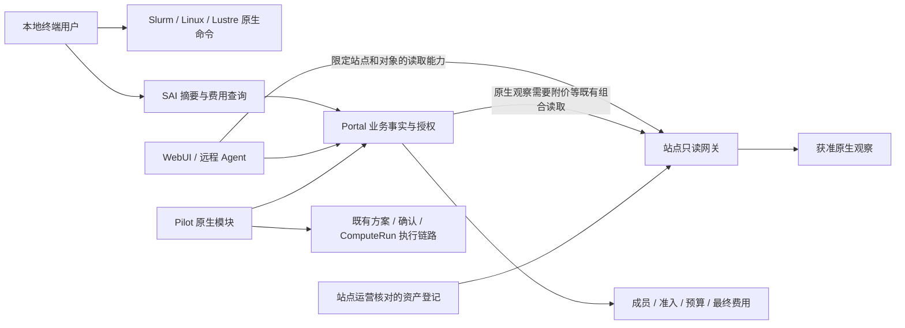

# WebUI、终端与 Agent 共用语义设计

状态：目标设计与当前实现水位；未实现的新接口、命令、权限和组件仍为设计目标。

范围纠正：2026-10-06。共享事实和权限，不要求各端具有相同功能或完整工作台。

当前交付核对：2026-10-07。终端摘要和单作业费用查询已共享发布并用普通用户验证；
原生配额已通过一个个人范围的正式签发、读取及 journal 对账。详见
[终端范围](terminal-scope.md)、[费用读取](billing-read-plane.md)和
[站点读取](site-local-read-plane.md#native-lustre-quota)。这些结果不替代 Pilot
原生入口的配套发布、Portal 旧计算页面退役或硬件资产/遥测验收。

## 1. 目标与本轮边界

SAI 支持用户准备计算、跟踪执行、诊断、取得结果并理解费用。Web 计算体验由 Pilot 原生作业插件承担；终端用户继续使用 Slurm/Linux，SAI 只补充原生工具缺少且有实际用途的信息。各端读取同一对象时遵循相同事实和权限，不要求每端覆盖整条流程。

主线是清楚的产品职责和可复用的授权数据。TUI 按[终端范围](terminal-scope.md)收敛为简短的 SAI 信息补充，撤回完整任务工作台要求。Web 数字孪生继续按角色分层，先贯通用户任务与硬件，从资产清单生成参数化模型；Agent 直接读取结构化事实，设计见[专项设计](digital-twin-design.md)。3D 美术与多站点拓扑实现继续后置。

本设计不改变当前 CLI 只读边界，不新增真实提交、取消、配额或资金操作。未来交互操作复用已授权的 Portal/Pilot 执行链路，CLI/TUI 写入口须另行完成架构评审。现有 API 的替换须跨仓协调；文中的逻辑 operation 名不是已经注册的 HTTP 路径或 capability 权限。

### 产品与模块边界纠正

用户的目的，是完成自己的科学计算、及时发现异常、取得结果并理解费用。
“选资源→准备→跟踪→结果→费用”描述系统需要支持的能力，不是要求每位用户
依次访问页面的向导。同一用户可按工作需要使用 Pilot、脚本或终端，均应容易
找到自己的计算。Web 日常计算交互由 Pilot 内部的作业插件承载；不在 Portal
重建一个与它平行的计算工作台。用户自行选择站点。

2026-10-03 的反馈指出：项目身份同时出现“作业”和“计算任务”，组织身份
入口又不同；资源准备仍要求理解 Pilot 工作空间。已部署代码确实分别按两套
读门槛显示导航，并把运行池选择呈现为工作空间选择。删除一个中转页、保留
文件位置和通过费用测试，都不足以证明这个产品结构合理。

后续收敛遵循以下决定；这是纠正目标，尚未完成迁移：

- Pilot 内的作业插件提供统一计算视图。个人、组织、项目决定获准范围，不再按
  `Slurm Job` 和 `ComputeRun` 两种后台记录分成平级产品入口。SSH 提交的
  计算必须保留；已有可信关联时，一次计算的原生执行信息并入同一记录。
  未关联对象不得按名称或编号猜测合并。组织汇总不自动扩大成员或文件权限。
  CLI/Agent 可消费同一计算服务和 DTO；共享合同不要求 TUI 提供计算列表、任务树或对应页面。
- 进入 Pilot 不要求先在 Portal 管理运行池。会话、工作目录、原生历史与
  日常工作由 Pilot/上游工作台负责。运行池和使用窗口不能改名为工作空间或
  科研任务。资源偏好、任务及产物通过已有授权引用传入该模块。
- Portal 保留账号、成员、站点准入、付款权限、计算意图及最终账务的权威。
  `ComputeRun` 是计算服务记录，不属于 Pilot 私有状态；TUI 和普通脚本使用
  的读取能力不依赖 Pilot 可用。授权边界不能因为界面迁移而随之下放。
- Pilot 专属呈现、工作区交互及运行时生命周期由独立模块/原生插件拥有；
  Portal 集成层只负责入口、当前业务授权与版本化契约适配，不在 Shell、
  资源页、结果页分别实现 Session/Pool 状态机。先用已有模块和适配接口
  完成分离，不为一个集成新增通用插件市场、服务总线或任务引擎。

现有 Pilot 客户端插件已通过原生 `conversation.view`、`conversation.composer`
和工具视图插槽注册 `TaskView`、`ProposalComposer` 等组件；已有日志、产物、
费用、统计、位置读取及原生文件打开接口。后续先补齐这个模块的发现和连续
使用能力，再退役重复 Portal 页面。不能只把 Vue 页面移入另一个目录、嵌入
iframe，或以统一列表为由新增 Portal 专用聚合服务。插件面板直接读取获准
数据，Agent 工具消费相同事实；查看作业、日志或结果不需要额外发送模型消息。
插件存在不代表全部原生作业发现、跨会话读取及完整体验已通过验收。

产品取舍以可观察的用户结果衡量：首次找到并开始自己的工作、重返已有工作、
独立定位失败、取得目标文件；运营关注普通问题能否自行解决以及每次变更的
交付成本。用户测试给出这些目标而非按钮点击脚本，不以接口数、页面数、
跨端跳转成功或测试数量作为产品价值。视觉首先帮助辨认当前工作和下一步，
不替代对象与职责设计；硬件数字孪生继续后置。

实施时先与 Pilot 原 owner 对齐原生插件和读取契约，复用已有组件，再配对
迁移旧链接及删除重复页面。工作台工作负责共享计算读合同、TUI 与迁移消费端；
Pilot 原 owner 负责原生插件、入口与运行时，避免两个线程同时改同一模块。
新增 Portal 统一列表草稿已撤销；费用扩展候选暂停，不以继续加功能代替纠正。

## 2. 已有基础与缺口

| 能力 | 目前可以复用 | 仍需补齐 |
| --- | --- | --- |
| CLI | `sai` 简短身份/资金/访问摘要、`sai jobs cost JOB_ID` 单作业预估及授权 JSON 命令；已共享发布并通过普通用户读取 | 完整用户理解与长期体验；不再以增加终端功能代替其它端交付 |
| WebUI | WorkspaceShell、发布目录、资源准备入口、原生分配与登记位置、受管任务深链/日志/输出清单与有界文本读取及最终费用、原 Session 续接 | 完整浏览器结果流程、硬件遥测、运行估算到结算的替换、完整流程现场验收 |
| Pilot | 原有 AgentSession/ComputeRun、MCP 原生只读工具、作业/结果/资源引用交接与原生结果预览 | 独立演进的原生多会话准入、有明确问题的结果分析及完整用户流程验收 |
| 资源事实 | 发布目录、原生节点/GRES 分配、作业节点的运维资产登记合同、Lustre 按需配额、独立存储采样 | 当前机器实例真实性、物理 GPU 映射、设备归因、真实利用率与现场发布 |
| 可视化 | 原生分配的节点示意、登记 U 位局部标记、现有主题与终端视觉规则 | 当前现场布局、设备映射与遥测；整体体验及真实环境验收 |
| 共享契约 | 发布目录、原生作业/分配/配额、受管任务/最终费用/统计及跨端续接的版本化合同 | 执行实例长期关联、估算到结算生命周期、三端现场一致性验收 |

资源目录的节点数量不能展开成真实资产；作业 DTO 的 `reason_or_nodelist` 不能充当结构化分配关系。公开首页的硬编码场景不作为机房清单。已有“3D 材质”视觉改造与本设计的硬件孪生是不同切片，继续由原 owner 维护。

当前共享读取的 source schema 已核对：Portal 与 CLI 的 19 份合同一致。Pilot
对应合同的差异仅为尚未消费的可选 `run_link`/`run_ref` 属性，其白名单投影会
舍弃这些属性；不能把这一兼容行为写成已经完成了跨记录关联，也不需要为保持
文件相同而给消费者增加无用途字段。原生分配、费用、配额与结果各自仍有独立权限。

Portal 主线仍保留 `PortalJobsPage`、`PortalRunsPage` 及其原路由，不能宣称
计算体验已完全迁入 Pilot。接续由原 Pilot owner 配对交付原生入口和读取配置，
在用户能直接找到任务、查看/取走结果和理解费用后，配对迁移旧链接并删除重复页面。
该接续不需要再做一套 Portal 列表，也不等待完整 3D。

当前登记位置切片已有源码实现，本地合同和交互验证与正式发布分别记录。
`jobs.placement` 是独立的精确作业读取，需站点显式开放；响应自带本次使用的
完整 allocation，仅关联其中的节点。登记、过期、未映射分别呈现，不从同名
主机推断当前物理实例。Web/CLI 显式读取，Pilot 直接消费相同结构化事实；
不下载全站清单，也不新增资产状态数据库。机柜片段只标注获准节点的 U 位，
不代表完整机柜占用，未展示区域不能解释为空位。

统一作业切片已配对发布：Portal 作业列表/详情按需展示
同次原生观察的状态与费用，流水保留已结算账目和服务端敞口汇总，移除第二份
运行作业列表与独立轮询。批量 `jobs cost` 保持完整财务快照合同；TUI 删除
独立预估列表，在所选作业内显式读取同次状态与费用。四端共用事实与金额语义，
按各自交互方式呈现。
先前真实用户空列表、签发/journal 关联和自然到期验收继续有效，不能用来证明
正向详情/分配、显式撤销或完整任务旅程已完成。

## 3. 共用信息架构

以下记录原终端工作台的已部署行为，相关 TUI 界面现已从源码移除。
受管任务结果引用交接曾配对发布，用户确认可见原会话与文件引用。原 TUI 文件列表显式选择，控制台恢复同一
有界页与文件引用，由任务页的明确动作打开原 Pilot Session。主线已移除重复
确认中转页，打开失败保留原任务，切换对象后迟回不再导航；这项交互改动已
部署，先前用户可见性确认不替代新版完整流程验收。原生预览与输入框
插入继续使用 DSH 接口；没有第二文件查看器或任务引擎。同名 Run 工具迁移到
现有独立 READ 服务，历史付款方变化不再隐含撤销读取。原会话文件根必须与
Run 冻结目录一致，不能在另一个目录打开同名文件。本次用户确认仅覆盖会话与
引用可见，未覆盖正文预览、插入、下载或分析。结果主流程仍未验收；引用交接
是可选衔接，不应成为查看结果的必经步骤。

沿用当前工作区骨架。工作身份、站点、计算/付款身份、文件位置分别显示，不能用一个“模式”合并。有效 URL 的显式范围优先；无权限时停在该范围并解释原因，不自动切换到个人账号。

下表的日常计算 WebUI 位于 Pilot 原生插件内；账号与组织管理、账户总账仍由
Portal 承载。现存 Portal 计算页面是待迁移消费者，不是另一个长期工作台。

| 入口 | 用户要解决的问题 | WebUI | TUI | Agent 读取 |
| --- | --- | --- | --- | --- |
| 工作概览 | 什么需要我处理，怎样继续 | 活动任务、待确认、异常、最近结果 | 简短的 SAI 身份、资金与相关访问事项；不建任务首页 | 活动任务、待处理动作及引用 |
| 任务 | 为什么等待，在哪里运行，结果是什么 | 时间线、资源/日志/结果/费用详情，跳转硬件 | 原生 Slurm 与现有命令；不要求任务树或日志浏览器 | 任务/尝试/分配/证据/结果引用 |
| 资源 | 哪种配置满足需求，当前能否使用 | 条件筛选、方案比较、硬件视图 | 原生资源查询及显式 SAI 价格目录命令；不建准备流程 | 规格、准入、容量、约束与来源 |
| 数据与结果 | 数据能否访问，空间是否足够 | 文件位置、读写权限、占用、产物 | Linux 工具及必要的远程读取命令；不建文件管理器 | 授权文件范围、采样与结果元数据 |
| 用量与费用 | 消耗了多少，预算还能否支持 | 运行估算、最终消费、预算分别呈现 | 已有摘要和费用命令；交互仅用于减少必要的查询输入 | 估算、结算、预算独立只读操作 |
| 分析与继续 | 能否解释或继续这项工作 | 在当前原生工作台将选中对象交给 Agent | 使用 Pilot 自己的入口；不把续接做成终端主流程 | 原生工具查询相同事实、引用来源 |

表中不要求 TUI 对应实现每一行。Web 内的任务入口复用同一对象，不新建一个“工作台任务”数据库。ComputeRun 仍表示受管计算；普通原生作业可以被查看，但没有真实关联证据时不伪造 Pilot 会话、方案或文件关系。

### 页面职责与导航规则

用户不应为了理解一次计算而在多个弹窗和中转页之间拼接信息。统一工作台的
稳定上下文是所选账号/项目、站点和正在查看的任务；后台服务的拆分不决定
前台页面如何拆分。以下规则是目标交互，现有页面按完整路径逐步收敛：

| 页面或操作 | 职责与去向 |
| --- | --- |
| 工作概览、资源 | 发现需要处理的任务、选择资源；选中资源后只进入必要的准备步骤，保留原选择 |
| 作业插件 | 在 Pilot 内找到目标计算；已证明关联的原生作业属于任务的执行信息，不要求来回查看两份记录 |
| 任务详情 | 留在 Pilot 原生工作台；概况、日志、资源/硬件、结果、费用属于同一对象，复用原生视图和文件组件 |
| 文件 | 在任务上下文内查看或获取；不以进入聊天为文件读取的前置条件 |
| 分析与继续 | 作业视图和 Agent 在同一原生工作台，按需交给 Agent，不为普通读取发送消息 |
| 账户、协作、账务、身份 | 保留各自独立职责；一次任务的费用可在详情查看，账户总账才进入账务页 |

普通查看只需一次明确操作；没有新选择、费用、修改或外部披露的确认页应退役。
需选择文件空间/会话时在当前准备步骤完成；身份提供方要求的登录/同意以及
提交、删除、续用的必要确认仍保留。不会为减少跳转而复制 Pilot、把所有功能
塞入一个页面，或将不同权限域合并。

浏览器后退、前进、刷新、直接链接与页面内返回应指向一致对象；返回列表保留
筛选、页码/游标与可定位的原行，范围或身份变化则清掉旧数据。视图切换不把
每个标签塞入浏览器历史，也不把长日志放进多层独立滚动容器。键盘焦点跟随
当前任务，手机用正常页面阅读，弹窗留给短暂选择和必要确认。

验收时从“选资源→准备→跟踪→诊断→结果→费用”实际走完一遍，并验证反向
返回和失败恢复。能够列出所有页面不算理解体验；用户无需反复寻找自己刚才
的任务和文件，才是这套导航成立的证据。

### 全局审视：入口、对象和去向

2026-10-03 审查现有路由、页面及读取合同后，采用以下产品判断。此表是收敛方向，
不是已完成全部实现或真人验收的声明；不另建工作台外壳、任务库或导航服务。

| 当前入口与实际路径 | 用户意图与问题 | 保留、合并或退役 |
| --- | --- | --- |
| 通行证/工作区概览中的资源目录 → 资源准备 → Pilot 入口 → 原生工作区 | 选择资源后还要经过项目确认和工作区选择；来源项目已确定时，单独的“继续”页没有新决定 | 保留发布目录，将资源引用交给 Pilot 插件；必要选择在原生工作台完成，退役 Portal 的运行池选择与无新决定的中转 |
| Pilot 独立入口 → 工作区/会话 | 完整 Agent 还承担代码、文件、分析等工作，不限于提交一次计算 | 保留完整原生工作区和直接入口；打开既有工作不应重复启动或确认 |
| 计算任务列表 → 详情 → 日志/结果/费用 | 用户追踪一次已受理计算；切换内容时不应丢掉正在看的文件 | 复用 ComputeRun 读服务，在 Pilot 已有任务插件中呈现；配对迁移深链后删除重复 Portal 页面 |
| 作业列表 → 当前分配/估算 | SSH/脚本用户需要查看原生调度器作业，未必存在 ComputeRun | 保留原生读取能力，迁入同一计算入口；可信关联属于同一计算的执行证据，不保留两个平级菜单要求用户选择 |
| 任务文件 → 正文/下载 → 可选分析 | 读到和拿到结果是直接目的；只有解释、排错或继续工作才需要 Agent | 原生文件视图直接打开或取回获准产物；同一工作台内按需交给 Agent |
| 任务费用 → 账户资金/流水 | 一次计算的费用与账号总账是不同问题 | 单次费用留在任务；总账独立，删除已被同次作业观察取代的预估列表与轮询 |
| 身份、成员、站点开通、操作记录 | 开通和管理是计算的条件，不能混作计算步骤或计算任务历史 | 保留领域入口及必要确认；完成后回到原工作区/站点，不要求重新寻找入口 |

**对象必须讲清楚。** Pilot 原生会话承载目标、讨论和分析，ComputeRun 记录一次
受管计算，Slurm 作业是其执行证据或独立提交。Pilot runtime/pool 承载会话，
不能因为后台返回 `tasks` 就把它与计算任务混称。关联只用现有服务确认的引用；
没有关联证据的作业不能被前端补造为受管任务。这些区别不要求用户理解数据库。

**统一交互不合并权力。** 用户明确选站点，地址可独立或共享入口。Identity
拥有登录，Portal 拥有成员、计算授权、任务记录与最终费用，站点读取本地动态
事实，文件 owner 提供获授权产物，Pilot 保留完整 Agent 执行能力。三个客户端
复用现有合同；一页组合多种事实时保留各自来源、时间和权限，不增加聚合写服务。
运行估算与最终费用必须靠执行实例及冻结付款方关联，不能靠同名或 Job ID 拼接。

**视觉服务于辨认和操作。** 页面固定呈现工作区、站点、当前任务和返回路径，
主内容按概况、日志、输出、资源和费用组织。采用既有结构化新拟态和共享控件，
表格与长文本保持平整；常用操作只有一个明确入口，技术标识按需展开。桌面为
证据比较提供空间，手机保持正常文档阅读；不靠增加说明卡、装饰或弹窗弥补路径
不清楚。3D 是同一资源事实的可选视图，仍须有文字替代，不成为查任务的前置步骤。

实施顺序：先冻结上述对象与页面职责，收敛现有任务阅读及返回行为；紧接着合并
资源到准备的无意义中转，与 Pilot 原 owner 配对确认入口。随后验证同次执行的
估算到结算及原生 Agent 消费，再扩硬件数据。每项改动按完整往返路径验收，
不以某个按钮、合同测试或下载成功替代整体完成。任务详情与准备入口已于2026-10-03配套部署；公网制品与服务检查通过，
它们仍不替代完整真人流程验收。

验收覆盖两条真实路径：已有项目/站点的用户“资源→一次准备→原生工作→计算
记录→日志/结果/费用”；熟练用户“原生提交→集群作业→执行证据/费用”。同时
检查冷登录、浏览器后退/刷新、第二页文件、失权及原会话不可用；通用 Agent 工作
不能被迫先建计算任务。源码、夹具浏览器、真实登录用户与现场原生数据分别留证。

[登录摘要设计](login-summary-design.md)是工作概览在登录时的简短呈现：当前身份、获准资金、
未读消息和需行动事项，复用相同领域事实。它不新增任务库、消息已读状态或资金计算；
`sai status` 与相关摘要合同已实现；`sai tui` 源码已复用同一简短输出；部署及现场验收仍单独记录。

## 4. 核心用户流程

### 资源选择与运行准备

以下为已有准备链的实现记录，TUI 的该入口按终端范围退役，不要求继续补齐：
已部署 TUI 从站点发布目录选择候选，并提供比较。它与网页目录进入同一准备页，重新读取指定分区，再
在现有 Pilot 入口内选择计算项目和既有/新工作空间；没有独立的继续中转页。
项目已确定时直接显示目标工作空间，未确定时在同一页补选。刷新、返回和项目
变化保留所选资源，每次打开前重读发布目录和当前项目权限。原始准备 URL 保留，
后端启动/打开/续用仍只有原入口的显式动作。引用只能经用户操作带入原生
输入框，不能自动发送、启动或续用。无需先有历史作业，也不猜一份默认可提交
脚本或 JobCandidate；具体校验、报价和方案确认继续复用已有服务。

资源草稿的项目是来源计算意图，目标 Pilot Session 可以使用独立的文件空间。
发布资源按站点和分区核对，不能要求计算项目与 Session 文件空间的标识相等。
原项目意图随引用保留；计算归属、付款方与执行许可仍由校验、方案和确认链核定，
不由文件位置或一次资源读取决定。

用户选择计算身份、站点、文件位置，输入 GPU 显存/数量、CPU/内存、软件及预计时长等要求。后端返回适配、权限、额度、资源状态与缺失条件，用户比较两个有依据的方案，再交给 Pilot 准备运行方案。

规格满足、当前空闲、本人有权使用、额度允许和调度器最终分配是五个独立事实。“有空闲”不承诺立即启动；无队列预测来源时只展示当前排队原因。报价和预算检查来自服务端，不由浏览器、TUI 或 Agent 自行计价。

### 运行跟踪与诊断

从任务进入同一执行尝试，可看排队原因、已分配服务器/GPU、观测时间、日志和费用。WebUI 点“查看硬件”选中孪生实体；终端不要求复制该资源树。点“交给 Pilot 分析”传递对象引用，Agent 重新授权读取并给出带证据的解释。

低 GPU 利用率只说明观测事实，不能单独断言程序错误、I/O 瓶颈或取消任务。解释必须注明时间窗口、采样覆盖及支持/缺少的证据；建议改配置须生成新方案。

### 结果与消费

结果页首先帮助用户回答“运行怎样结束、产生了什么、如何查看或取走”。当前
页面已有状态、日志、文件名/大小/时间及费用，并已发布同任务文本和完整文件
下载。普通用户 CLI 取回原文件通过，浏览器完整流程仍待验收。

| 用户目的 | 主操作与完成标准 |
| --- | --- |
| 判断运行情况 | 在同一任务查看已知执行状态和日志证据；执行结束不等于科学结果正确或收敛 |
| 查看或获取产物 | 从所选文件直接进入获授权的正文查看或获取动作，不要求打开聊天、启动模型或续用额度 |
| 排错、解释或比较 | 用户有明确问题时再把同一任务/文件带入 Pilot；引用可见不算已经读取或分析 |
| 调整后继续计算 | 由 Pilot 既有方案与确认链处理，打开引用不隐含提交、修改文件或付费执行 |

“打开同一任务的一个获授权文本产物并读到内容”已有配对源码和本地文件/API/
浏览器验证：Web 文件名与 TUI Enter 进入同一任务的正文阅读，返回恢复文件页。
JSON 与 Agent 内部读接口共享有界内容 DTO，读取保留现有文件领域权限和根目录
约束。文本与独立完整下载已配对发布，普通用户日常 CLI 取回现有文件通过；真实登录
浏览器的完整结果流程尚未验收。有界预览与完整下载分别标识。Web、TUI 与
Agent 共用对象和读取语义，各自采用合适的呈现，不再各建文件权限或结果库。
任务可见不自动授予文件正文访问；原会话不可用不应成为结果读取的产品前提。

文件名激活应对应查看，选择只用于后续操作；结果内容、运行证据和当前动作
占主要空间，技术标识收进详情。保持既有视觉系统，Pilot 衔接作为次要操作。
已实现部分按源码/部署/现场分别验收，不能通过更名按钮、增加解释文案或假定某个文件
是“主要结果”来关闭。没有产物、无文件权限、文件已变更或格式不能预览时，
给出真实状态与可用操作，不生成未经证据支持的结论。

已完成任务保留尝试、日志游标、产物引用和结算状态。运行估算与最终消费使用明确的服务端关联；结算未到时标为等待结算。不能把两者相加，不能用最终账单替代实时执行状态，也不能把最终费用倒填进先前观测时间。

已退役 TUI 的作业内费用模式曾复用同次原生观察和中心估价，删除独立预估列表；
手动刷新替换状态与价格，普通作业仍按配置直读站点。Center 与共享客户端已
配对部署；真实历史任务及其日志、输出、最终费用读回通过。当前队列为空，
不能把历史任务证明升级为运行预估；另有用户会话/引用可见确认，仍不证明结果主流程完成。
Run 最终费用目前仍是独立的已结算事实，pending 不证明任务已结束。后续
估价到结算须复用 Run 的执行实例证明、冻结付款方和现有财务可见性，再由
同一费用区替换展示；不能把普通 Jobs 的当前付款方或数字编号当作关联。

### 跨端继续

在确有用途的跨端链接中，目标应保留显式身份、站点、任务、执行尝试和时间选择，并重新核权。这是链接合同，不是要求终端增加导航或续接流程。从硬件进入 Pilot 使用已有会话或用户明确选定的新会话。关闭视图不取消 ComputeRun，不延长 runtime 授权窗口，不自动续费。

## 5. 一套语义，适合各端的交互

WebUI 沿用当前 WorkspaceShell：范围、列表和所选对象共用上下文。作业和
受管任务详情已使用工作区内页面；内容切换应保持原任务、文件选择与返回路径。
手机优先任务、列表与决定，3D 由用户主动打开。

TUI 的完整工作台方向已经撤回。当前 `sai status` 可显示身份、资金、访问问题和
简短消息并返回 Shell；费用使用现有显式命令。需要补充的交互必须证明它比
原生工具和现有命令减少了什么操作。按名称选择优先于技术 ID 输入，但不能
因此新增一个账户、资源、文件和任务齐全的终端应用。详见 [DESIGN.md](../DESIGN.md)。

已部署全屏实现、序列化读取及本地/现场技术验证保留在
[实现记录](terminal-workbench.md)。停止以更多任务树、快捷键或布局优化推进该方向。
Codex CLI、Claude Code、OpenCode 仅作为聚焦交互、操作发现和渐进呈现的参考；
保留一个简短答案即可解决的问题，不复制它们的完整 Agent 外壳。

设计延续 SAI 控制台的结构化新拟态、现有皮肤/明暗/语言，不建立第二套主题。表格与长日志保持平整可读；颜色同时配合文字或图标。键盘、屏幕阅读器和无 WebGL 用户可以完成全部读取与决策流程。

| 状态 | 统一行为 |
| --- | --- |
| 首次加载 | 展示明确区域骨架；不先填 0、空闲或健康 |
| 无任务/无资产 | 区分合法空结果、清单未接入、未获得权限 |
| 部分数据缺失 | 已授权且有效的数据继续展示；缺失层显示来源和状态 |
| 网络失败/观测过期 | 保留允许保留的上次结果并标记时间；停止“实时”标识 |
| 登记位置失效 | 读取前清旧登记；来源失败、撤回或到期不恢复旧位置，独立分配仍可读；权限失效按原范围清理 |
| 短期凭证到期 | 暂停受保护读取；有效会话下复用现有一次有界、single-flight 刷新，成功后恢复 |
| 会话失效/权限撤销 | 刷新失败、最终 401/403 或已知撤权时，清空对应敏感视图与缓存，提示重新认证或权限变化 |
| 切换范围 | 取消旧订阅，清理旧范围数据，旧响应不得覆盖新视图 |
| 重连/事件缺口 | 重新核权并获取完整快照，不以缺失增量猜状态 |
| 运行/完成 | 以服务端事实推进，不把按钮点击或请求受理当成执行成功 |

## 6. 领域所有权和读取路径

图表示领域责任与授权路径，不是新增聚合微服务或所有客户端均已接通的声明。
Identity 保持身份认证 owner；Portal 维护业务准入、可见范围和最终计费；站点运营
发布经过复核的资产登记，站点适配器采集原生观测；Pilot 维护 runtime/session；
CLI 与 WebUI 做交互和展示。

本地身份已能读取的事实直接走原生命令，不为统一界面绕经网关。SAI 费用由
业务服务取得同次原生观察并附价，本地调度器不拥有商业计价事实。网关是远程
授权读取设施；用 CLI 验收它不构成本地用户切换工作方式的要求。当前登记发布
由受控的站点签名清单实现，不再另外维护一份浏览器资产库。

资产清单由站点运营维护和复核，沿既有签名发布路径供网关按获准节点投影，
Portal 解析当前读取权限。遥测先复用实际已有的观测设施；没有设施时先完成窄
采集契约和权限评审，不要求为每个页面部署采集器。物理资产存在不等于使用权。

统一作业实现将交互估价的旧 site-agent reader 替换为 capability 网关原生观察，
既有计费 worker 保持自己的采集与写入归属。高频孪生不能重新引入 broad
site-agent 路径；中央费用、权限或资产投影也不能被站点网关反向取代。

### 动态事实优先原生按需读取

站点本地 Slurm、Lustre 和设备遥测是动态事实的首选来源。请求经窄读取入口直接使用原生命令/接口，并规范化响应；不先将全量原生状态复制到中心数据库，再让页面查询副本。客户端消费相同 DTO，不各自实现原生解析。远程浏览器经必要的转发到达该入口；转发不增加第二份数据权威。

| 内容 | 首选读取 | 保留边界 |
| --- | --- | --- |
| 当前作业、实际分配 | 本地 `squeue` / `scontrol` 窄读取器 | 按授权过滤，保留原生观测时间；不从 ComputeRun 缓存猜当前运行状态 |
| 分区/节点当前状态 | 本地 Slurm 元数据接口 | 与已发布规格、用户准入和销售价格分开，不为页面发明调度规则 |
| 用户/项目用量与配额 | 有授权的 Lustre 原生 quota 查询 | 绑定实际文件系统和 quota subject；不把任意子目录占用当 project quota |
| GPU 利用率等 | 节点现有遥测或原生设备读取 | 保留采样窗口、设备代次和归因覆盖；不由分配量推算 |
| 执行意图、成员与费用 | Portal 已有业务记录 | 保留幂等、确认、回执、审计和结算，不能由一次 native read 取代 |
| 物理布局 | 版本化资产清单 | 只存原生系统没有的布局和关系；不另建动态状态主库 |

按需采集不等于每个客户端各自每秒执行一次命令。同范围并发请求可合并，昂贵来源允许短暂复用上次成功观测；复用时明确时间和 freshness，不要求为了缓存部署一套新的中心服务。普通刷新不产生账务写入，也不触发持续采集或存储全量历史。

递归遍历大目录不是即时读取合同。原生配额能回答的问题直接查询；任意目录的精确占用在没有低成本原生接口时，明确发起有界分析并显示采集时间，不在页面加载路径执行无界 `du/find`。后续历史回放仅按具体需求、范围和留存窗口采集，不能成为当前读取的前置条件。

ComputeRun 表示已接受的业务执行及其持久记录，不是 Slurm 的镜像。任务视图分别展示业务状态和原生观测，关联使用服务端已确证的调度引用与作业代次。只读刷新不能替代执行 worker 回执写入；原生任务消失、源失败或状态时间不一致也不能被直接判为已完成。

作业的纯原生 `native_usage` 与状态、时间来自同一次读取，Center 在显式
`include_estimate` 下复用原价格与付款方可见性政策附价。无现金权限、缺价格
或计量事实只影响费用字段，不重定义调度状态。完整 `billing/v1` 继续独立读取
完整授权范围，不能把作业页面的 500 行当成总额。原队列的 `SETTLING` 与
`TERMINAL_GAP` 只表示保留观察的缺口，不证明调度结束或账务结清；流水中的
敞口只能来自服务端，不从这些行或状态求和。具体合同统一见
[计费读取边界](billing-read-plane.md)与[原生计量合同](portal-api-contract.md#native-usage-and-optional-estimates)。

## 7. 共用查询与对象契约

统一的是语义、对象标识、字段解释、失败状态和兼容测试，并不要求三端共用前端代码或同一个认证 token。沿用现有领域服务，发布中立 schema 与向量，由 Python、TypeScript、Agent 工具生成或校验 DTO；共享包不包含 ORM、权限引擎、原生命令或渲染依赖。

### 上下文和对象引用

上下文字段按 operation 声明，身份来自可信会话。目录浏览可仅需 site；作业读取沿用 scope/site/cluster 合同，`self` 拒绝 account selector，account scope 才要求授权账户选择。workspace、payer 与 file workspace 仅在对应领域需要时分别解析，读取资源不强迫用户拥有提交权、付款方或可写目录。响应包含解析后的范围与 visibility profile，客户端不能自行降低 profile 来取得数据。

共用引用：`task_ref`（已有 ComputeRun 时引用它）、`job_ref`、`execution_attempt_ref`、`asset_ref`、`incarnation_ref`、`allocation_ref`、`artifact_ref`。它们由有权威的服务签发，客户不能从名字、Unix 组、路径或数字 Job ID 推断关联。

原始 Job ID 会复用，重排队也可能产生新尝试。账务现有 `job_key` 可能随 submit/start 事实变化，不直接充当永久任务标识。缺少唯一证据时返回 `unresolved` 关联；服务端关联已确认后再连接 ComputeRun、调度分配和费用。

### 候选逻辑操作

| operation 家族 | 权威与返回内容 | 不能隐含授予 |
| --- | --- | --- |
| `context.read` | Portal 当前可选身份、站点、领域读取能力 | 任意账户选择、提交权限 |
| `resources.catalog` / `resources.eligibility` | 发布规格、软件约束、本人准入与限额原因 | 即时可调度保证 |
| `jobs.list/detail` / `tasks.read` | 原有任务状态、尝试、已确认引用 | 他人任务、脚本、原始路径 |
| `allocations.read` | 精确尝试到资产/设备的时变分配 | 管理员资源控制 |
| `twin.topology` / `twin.state` | 角色过滤后的拓扑、状态和质量 | 全站物理拓扑、其他租户占用明细 |
| `telemetry.query` | 白名单指标、实体、时间窗、单位、覆盖率 | 任意查询语言、标签或全局扫描 |
| `storage.usage` / `artifacts.read` | 授权目录采样/容量和产物引用 | 文件正文或父目录访问 |
| `logs.read` / `artifacts.content.read` | 既有 ComputeRun 日志/产物服务；单对象、游标/字节上限、独立内容权限 | 任意路径、未授权文件、通过作业可见性获得正文 |
| `resources.quote` / `budget.read` | Portal 报价和预算服务；带有效期的方案估算与获准预算摘要 | 资金操作、全账本、未授权付款方信息 |
| `billing.running-estimate` / `billing.settled.read` | 独立费用权限与非最终/最终事实 | 钱包、账本、他人消费 |
| `pilot.context.read` | 当前会话允许读取的对象引用与证据 | 新会话、续额或执行批准 |

既有 site-read operation 不自动扩展到此表。已实现的 `jobs.placement` 也不授予
全站资产或管理员视图。每个新增操作须完成 issuer、consumer、工具描述和服务端
过滤的配对版本工作；管理员操作保持独立权限面。

### 结果和一致性

新 envelope 明确 schema/version、snapshot ID、解析范围、查询摘要、source/observed time、有效时间段、staleness、覆盖率、分页 cursor、实体/拓扑版本和 request ID。每个数据层各自标时，不能用页面刷新时间掩盖旧来源；现有 jobs/estimate DTO 通过显式版本演进接入，不就地改名或删字段。

数据值支持 `known`、`unknown`、`unsupported`、`stale`；鉴权失败使用有界错误而非伪装为空列表。源异常可在授权完成后返回 `partial` 与允许展示的层状态。零是已测得的数值，不能代表未知。可提供的管理员诊断也经过 allowlist。

列表必须有稳定排序、上限和绑定范围/筛选/版本的 cursor；不能对一次 `limit=100` 的结果在前端假分页或当作全量统计。服务端分别声明 `matched_total` 是否精确、是否截断，聚合范围与行范围一致。

同一画面可由多个快照组成，但响应给出各自时间和关联版本。默认联动查询固定同一查询窗口；无法一致时显示“数据时间不同”。历史查询独立于 live contract，不给当前 live source 添加静默 accounting fallback。

## 8. 刷新、缓存与数据规模

第一阶段使用有界 HTTP 快照与条件读取；作业沿用现有合同。新高频观测建议 5–15 秒，视图隐藏时暂停或降频，具体采集周期由源声明。刷新周期不驱动费用持久化。无需先建立通用事件总线或无限时间序列仓库。

客户端同范围同查询合并请求；鉴权刷新 single-flight。缓存隔离包含 actor、operation、site/cluster、scope/selectors、标准化筛选与时间窗、source、visibility、policy epoch、schema/data revision；capability 路径另含 grant digest/JTI 与授权到期时间。缓存命中与条件读取/304 均重核权限，不能绕过授权。

不得将包含私有工作区的结果存入跨用户公共缓存。旧数据展示须在明确的 display-retention 与有效会话范围内；capability 到期后暂停受保护读取并续取，不能把旧值标为仍获授权的实时响应。仅网络/来源暂时失败且授权仍有效时保留标明过期的值；已知撤权或会话失效立即删除敏感缓存。

登记位置采用更窄的保留边界：有效期届满即清除位置展示，不能等普通刷新周期，
也不自动发起新读取。成功读取时用响应内 allocation 与登记一起替换，不能将新
登记拼在旧节点列表上。ETag 和作业编号都不作为永久设备实例或执行尝试标识。

后续有需要再给已有投影增加增量订阅。事件须有 snapshot/sequence、游标、撤权与 gap 语义；错序、缺口和跨拓扑版本时重取快照。限流与断线使用有界退避，不把每个图形/Agent 子任务变成原生采集请求。

实现验收建议覆盖空集合、单任务、500 条分页结果、千节点聚合和高延迟源；这些是合成容量测试，不能当作现场规模或性能承诺。

## 9. WebUI 与 Pilot/Agent 接入

复用 Pilot 已有原生插件、Session、MCP/HTTP 工具及 browser projection。Portal
保留业务授权和后端核定的 HTTPS handoff；现有 start/resume/renew/open 浏览器
编排由原 owner 收敛到原生入口，不作为各 Portal 业务页的长期依赖。
控制台与 Pilot 可以使用不同域名。
Job、Run 和资源引用通过既有 bootstrap URL 的 `sai-context` fragment 传递，
目标原生客户端清除 fragment 后，按现有 schema 和 Session 绑定消费；来源域
session storage 不承担跨域搬运。引用不含权限、凭据、路径或自由提示词，
不自动发送、启动或续用。发送端与接收端需配对部署，本地测试不代表现场验收。
对话、子 Agent、Shell、Git、Skills、Workflow 和长期任务能力保留；不再建立聊天库或第二任务引擎。

选择任务或硬件后，用户可把 `object_refs + scope_ref + snapshot_ref + time_window + question` 带入会话。引用不是权限凭证；服务端重新核权、解析可信对象、检查当前 Session 的完整绑定。历史上下文显示原观测时间；Agent 若刷新到新事实须说明变化。

会话固定的工作区/站点/文件 mount 不因点击对象改变。当前会话范围不适配时，提示用户选择相匹配的既有会话或显式建立新会话，不能后台改绑。普通数据读取也不能隐式 start/renew runtime；允许的计算准备与预算仍遵循既有合同。

现有 ComputeProduct principal 要求计算项目、提交权与可写目录，不能作为通用只读入口的前置条件。新读取工具复用 Portal 对应读权限，并保留可信 actor/session/scope 绑定；无需复制成员表、授权表或把 WebUI token 注入模型。`agent_only` 与 CLI `enabled` 的既有渠道差异继续显式执行。

Agent 直接调用白名单结构化工具。每个工具有输入 schema、operation、所需权限、分页/结果上限、时间窗和错误码；默认返回摘要与证据引用，再按需展开。禁止用截图/DOM 作为事实 API，也不暴露任意 SQL、PromQL、管理 API 或 native-command 代理。

一个典型问答：用户问“这次运行为什么 GPU 很闲”，Agent 查询当前尝试的分配、对应时间窗内 GPU 指标、可授权的日志摘要和资源约束；回答列出事实、时间与不确定性，并引用可由 WebUI 或授权结构化读取核查的对象；不要求为此新增 TUI 视图。日志和任务名称是待分析数据，不是对 Agent 的可信指令。

生成方案与执行是两步。资源比较或模拟可产出建议；真实执行继续由既有 Proposal/确认/ExecutionGrant/ComputeRun owner 控制，绑定方案修订与幂等键。点击 3D 对象或 Agent 建议不构成提交、取消或迁移授权。

## 10. 实施顺序与验收门槛

| 阶段 | 可交付结果 | 验收；不包含什么 |
| --- | --- | --- |
| A：统一语义 | 对象引用、范围、查询/错误/新鲜度合同，共享兼容向量，现有接口映射 | 同 actor/scope/query 下三端读取一致；拒绝越权、跨代次和跨范围缓存；不声称新功能上线 |
| B：最小工作闭环 | Pilot 原生作业插件消费资源、计算、结果及费用契约，Agent 直接读取；终端只提供必要补充 | 用户在原生工作台开始或继续工作、诊断并取得结果；普通读取不需模型消息，不要求跳回 Portal 拼流程；旧页面按等价能力和授权深链配对退役 |
| C：孪生数据 | 清单导入、稳定实体、分配关联、一个真实遥测指标、版本/时间/缺失状态 | 先在 Web 文字/表格与 Agent 结构化读取中验证设备更换、作业重跑、GPU 无映射等场景；不等模型美术 |
| D：硬件空间视图 | 参数化机房/机柜/服务器/GPU、双向选择与时间联动、2D 替代 | 同数据驱动所有视图；有限真实样本逐项核对；视觉与性能单独验收 |
| E：高级分析 | 有观测基础的历史回放、诊断辅助和资源方案推演 | 预测显式标识模型/假设/置信度，不伪装实时事实，不自动操作硬件 |

贯穿验收：本人/组织/项目/MIS 角色矩阵；到期成员和被撤销授权；同节点其他租户隔离；GPU 分配不等利用率；失败不返回零；终态费用不重复；实际消费同一对象的客户端事实一致，不以三端跳转为验收目标；重连不重放执行；Agent 输出引用可复查；键盘、窄终端、手机和禁用 WebGL 可用。

验证记录分别写明 schema/static、fake HTTP、Portal 集成、真实浏览器、站点只读关联和生产发布。不同层级不能互相替代。后续 DSH 扩展实现前由 Pilot owner 重查官方上游和现有公开扩展点，本设计不规定 fork 或私有上游接口。

## 11. 归属、续接与未冻结内容

本候选由本次统一工作台设计线程维护。交付文件为根 PRODUCT、本文和数字孪生专项；仅作为本次设计入口，不替代 Portal 或 Pilot 既有架构权威。后续跨仓实施由对应 owner 将领域合同落到其仓库，并保持本入口链接一致。

保持并行线程的视觉 token、控件、Pilot runtime/handoff、文件授权、身份迁移和
生产发布归属。登记位置只推进独立读取合同和既有视图内的局部消费；不能把它
当作 A/B 完整任务旅程、终端视觉体系或 C/D 现场孪生已完成。后续按实际缺口
建立独立切片，3D 的真实布局和设备细节仍以来源验证为前提。

待实现阶段冻结：资产导入的实际源及更新 owner、遥测来源与留存期限、新 schema 发布载体、各操作最终 HTTP 路由、只读 Pilot 会话接入策略。未冻结不妨碍本设计作为统一语义基线；不得先用 mock 模型填补真实来源并标记完成。

## 12. 当前代码锚点

- sai-cli：`src/sai_cli/client.py`、`contracts.py`、`transport.py`；[架构](architecture.md)、[Portal 合同](portal-api-contract.md)、[站点读取设计](site-local-read-plane.md)。
- 登记位置：`src/sai_cli/site_placement.py`、`contracts/job-placement/v1/`；Portal/Web 对应服务与 DTO、Pilot `src/sai_pilot/job_placement.py` 共同消费该合同。
- Portal：`sai_core/api/routes/cli_read.py`、`services/slurm/job_visibility.py`、`services/slurm/resource_catalog.py`、`services/sites/resource_catalog.py`、`services/billing/running_estimates.py`。
- Portal/Pilot：`sai_core/api/routes/compute_product.py`、`services/compute/browser_projection.py`、`services/pilot/grants.py`；Pilot `src/sai_pilot/compute_mcp.py`、`compute_product_http.py`、`docs/architecture.md`。
- WebUI：`WorkspaceShell.vue`、`PortalPilotPage.vue`、`api/services/portal_site_resources.ts`、`portal_pilot.ts`；视觉规范仍由 Portal `docs/40-webui/webui_visual_system.md` 维护。

## 13. 工作台上下文配套交付

2026-10-03，Web任务阅读与单页资源准备已随共享工作区读取迁移一起部署。
工作区目录只提供项目、成员与站点；首页、管理及财务消费者从原财务接口读取
余额，慢余额请求不阻塞资源和任务阅读。原生作业与受管任务保留真实来源，
非财务页面退役无操作价值的通用余额显示，不新建账务事实。

任务的概况、日志、输出、资源及费用保留同一对象，返回文件恢复原页与阅读
位置；资源和项目、Pilot工作空间选择同页，进入或刷新不隐含启动/续用。
既有TUI链接合同保持，原生Pilot会话/运行时仍由其owner维护。

配套源码、静态manifest/checksum、公网文件和服务健康分别验证。真实登录
浏览器完整计算、正向当前统计、原生Agent消费及真实硬件映射仍未验收。
发布事实不等于上述产品目标已完成；详细站点证据在本仓之外保存。
