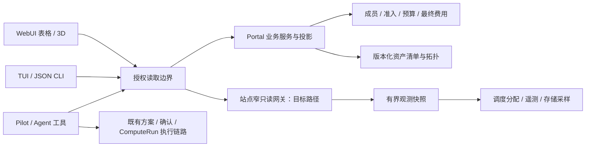

# TUI、WebUI 与 Agent 统一工作台设计

状态：candidate design；未实现的新接口、命令、权限和组件均为设计目标。

更新时间：2026-09-22 01:07:37 +08:00

## 1. 目标与本轮边界

用户从“准备完成什么计算”出发，选择可用资源和数据位置，跟踪排队与运行，定位低效或失败原因，再检查结果和费用。终端、网页和 Agent 展示同一任务及其证据，不要求用户在工具间复制标识或重新解释上下文。

本轮主线是统一产品逻辑、领域数据契约和 Pilot 接入设计。数字孪生作为资源与任务关系的统一表达写入[专项设计](digital-twin-design.md)，3D 美术、建模和渲染实现留在后续阶段。用户已确定按角色分层、优先贯通用户任务与硬件，并从资产清单生成参数化模型。

本设计不改变当前 CLI 只读边界，不新增真实提交、取消、配额或资金操作。未来交互操作复用已授权的 Portal/Pilot 执行链路，CLI/TUI 写入口须另行完成架构评审。现有 API 的替换须跨仓协调；文中的逻辑 operation 名不是已经注册的 HTTP 路径或 capability 权限。

## 2. 已有基础与缺口

| 能力 | 目前可以复用 | 仍需补齐 |
| --- | --- | --- |
| CLI | 登录刷新、窄 capability、PortalClient、作业与运行估算 DTO、安全输出 | 可选 TUI、异步请求调度、导航与视图状态 |
| WebUI | WorkspaceShell、身份/站点准入、资源目录、运行估算与已完成消费 | 同一任务到资源、硬件、文件和费用的关联视图 |
| Pilot | 原有 AgentSession、ComputeRun、方案确认、MCP 产品工具、浏览器业务投影 | 工作台选中对象上下文、更多按领域授权的只读工具 |
| 资源事实 | 分区/QOS 同步元数据、发布规格、价格、存储额度与采样 | 服务器/GPU/机柜资产关系、分配映射、真实利用率 |
| 可视化 | 现有主题与控件；公开首页有独立 Three.js 展示实现 | 可点选的授权硬件场景、实体到任务映射、遥测适配 |
| 共享契约 | 作业和估算语义已对齐到部分服务 | 单一版本化 schema/兼容向量及三端一致性验收 |

资源目录的节点数量不能展开成真实资产；作业 DTO 的 `reason_or_nodelist` 不能充当结构化分配关系。公开首页的硬编码场景不作为机房清单。已有“3D 材质”视觉改造与本设计的硬件孪生是不同切片，继续由原 owner 维护。

## 3. 共用信息架构

沿用当前工作区骨架。工作身份、站点、计算/付款身份、文件位置分别显示，不能用一个“模式”合并。有效 URL 的显式范围优先；无权限时停在该范围并解释原因，不自动切换到个人账号。

| 入口 | 用户要解决的问题 | WebUI | TUI | Agent 读取 |
| --- | --- | --- | --- | --- |
| 工作概览 | 什么需要我处理，怎样继续 | 活动任务、待确认、异常、最近结果 | 可排序待办与任务列表、详情 | 活动任务、待处理动作及引用 |
| 任务 | 为什么等待，在哪里运行，结果是什么 | 时间线、资源/日志/结果/费用详情，跳转硬件 | 任务树与详情、日志分页、同一任务深链 | 任务/尝试/分配/证据/结果引用 |
| 资源 | 哪种配置满足需求，当前能否使用 | 条件筛选、方案比较、硬件视图 | 同条件筛选、比较表、资源树 | 规格、准入、容量、约束与来源 |
| 数据与结果 | 数据能否访问，空间是否足够 | 文件位置、读写权限、占用、产物 | 目录范围与用量摘要、产物引用 | 授权文件范围、采样与结果元数据 |
| 用量与费用 | 消耗了多少，预算还能否支持 | 运行估算、最终消费、预算分别呈现 | 同字段汇总与明细 | 估算、结算、预算独立只读操作 |
| Pilot | 能否解释或继续这项工作 | 选中对象带入原会话，进入完整 Agent 工作台 | 上下文交接；协议具备后支持会话活动摘要 | 原生工具查询相同事实、引用来源 |

这些是同一任务的不同入口，不新建一个“工作台任务”数据库。ComputeRun 仍表示受管计算；普通原生作业可以被查看，但没有真实关联证据时不伪造 Pilot 会话、方案或文件关系。

## 4. 核心用户流程

### 资源选择与运行准备

用户选择计算身份、站点、文件位置，输入 GPU 显存/数量、CPU/内存、软件及预计时长等要求。后端返回适配、权限、额度、资源状态与缺失条件，用户比较两个有依据的方案，再交给 Pilot 准备运行方案。

规格满足、当前空闲、本人有权使用、额度允许和调度器最终分配是五个独立事实。“有空闲”不承诺立即启动；无队列预测来源时只展示当前排队原因。报价和预算检查来自服务端，不由浏览器、TUI 或 Agent 自行计价。

### 运行跟踪与诊断

从任务进入同一执行尝试，可看排队原因、已分配服务器/GPU、观测时间、日志和费用。WebUI 点“查看硬件”选中孪生实体；TUI 展示相同资源树。点“交给 Pilot 分析”传递对象引用，Agent 重新授权读取并给出带证据的解释。

低 GPU 利用率只说明观测事实，不能单独断言程序错误、I/O 瓶颈或取消任务。解释必须注明时间窗口、采样覆盖及支持/缺少的证据；建议改配置须生成新方案。

### 结果与消费

已完成任务保留尝试、日志游标、产物引用和结算状态。运行估算与最终消费使用明确的服务端关联；结算未到时标为等待结算。不能把两者相加，不能用最终账单替代实时执行状态，也不能把最终费用倒填进先前观测时间。

### 跨端继续

用户从 TUI 打开 WebUI，应落在相同身份、站点、任务、执行尝试和时间选择；登录后重新核权。从硬件进入 Pilot 使用已有会话或用户明确选定的新会话。关闭视图不取消 ComputeRun，不延长 runtime 授权窗口，不自动续费。

## 5. 一套语义，适合各端的交互

WebUI 使用当前 WorkspaceShell：顶部保持范围，中心放列表/比较/场景，右侧按需打开选中对象详情或 Pilot 上下文面板。3D 只占资源工作区，任务详情和数据表仍可独立使用。手机优先任务、列表与决定，3D 由用户主动打开。

TUI 采用可选依赖与独立入口设计，建议后续以 `sai tui` 为候选。左侧导航、中间结果、右侧或窄屏下的单独详情共用筛选状态；支持搜索、排序、暂停刷新、手动刷新、范围切换与 Web 深链。快捷键有可见提示，输入框编辑时不抢占按键。窗口缩窄为单窗格，状态不丢失。

TUI 初期通过单个有界后台请求执行器复用同步客户端，取消界面订阅后丢弃旧结果，网络请求仍受超时限制；不能声称线程包装实现了真正的网络中断。避免多线程并发刷新同一凭证。只有证明当前 transport 不足后才引入异步 transport。

设计延续 SAI 控制台的结构化新拟态、现有皮肤/明暗/语言，不建立第二套主题。表格与长日志保持平整可读；颜色同时配合文字或图标。键盘、屏幕阅读器和无 WebGL 用户可以完成全部读取与决策流程。

| 状态 | 统一行为 |
| --- | --- |
| 首次加载 | 展示明确区域骨架；不先填 0、空闲或健康 |
| 无任务/无资产 | 区分合法空结果、清单未接入、未获得权限 |
| 部分数据缺失 | 已授权且有效的数据继续展示；缺失层显示来源和状态 |
| 网络失败/观测过期 | 保留允许保留的上次结果并标记时间；停止“实时”标识 |
| 短期凭证到期 | 暂停受保护读取；有效会话下复用现有一次有界、single-flight 刷新，成功后恢复 |
| 会话失效/权限撤销 | 刷新失败、最终 401/403 或已知撤权时，清空对应敏感视图与缓存，提示重新认证或权限变化 |
| 切换范围 | 取消旧订阅，清理旧范围数据，旧响应不得覆盖新视图 |
| 重连/事件缺口 | 重新核权并获取完整快照，不以缺失增量猜状态 |
| 运行/完成 | 以服务端事实推进，不把按钮点击或请求受理当成执行成功 |

## 6. 领域所有权和读取路径

图中的读取边界是领域服务与 API 合同，不是要求新建一个聚合微服务。Identity 保持身份认证 owner；Portal 维护业务准入、可见范围、资产发布和最终计费；站点适配器采集原生观测；Pilot 维护 runtime/session；CLI 与 WebUI 做交互和展示。

资产清单先由站点运营维护版本化导入，Portal 发布授权投影。遥测先复用实际已有的观测设施；没有设施时先完成窄采集契约和权限评审，不要求为每个页面部署采集器。物理资产存在不等于该用户拥有使用权。

当前 Portal 到既有 reader 的路径只维持现有用途。高频孪生刷新必须以独立、低权限站点读取路径完成相应 gate；不能把中心同步访问 broad site-agent 作为新增高频页面的稳态方案。中央费用、权限或资产投影也不能被站点网关反向取代。

### 动态事实优先原生按需读取

站点本地 Slurm、Lustre 和设备遥测是动态事实的首选来源。请求经窄读取入口直接使用原生命令/接口，并规范化响应；不先将全量原生状态复制到中心数据库，再让页面查询副本。客户端消费相同 DTO，不各自实现原生解析。远程浏览器经必要的转发到达该入口；转发不增加第二份数据权威。

| 内容 | 首选读取 | 保留边界 |
| --- | --- | --- |
| 当前作业、实际分配 | 本地 `squeue` / `scontrol` 窄读取器 | 按授权过滤，保留原生观测时间；不从 ComputeRun 缓存猜当前运行状态 |
| 分区/节点当前状态 | 本地 Slurm 元数据接口 | 与已发布规格、用户准入和销售价格分开，不为页面发明调度规则 |
| 用户/项目用量与配额 | 有授权的 Lustre 原生 quota 查询 | 绑定实际文件系统和 quota subject；不把任意子目录占用当 project quota |
| GPU 利用率等 | 节点现有遥测或原生设备读取 | 保留采样窗口、设备代次和归因覆盖；不由分配量推算 |
| 执行意图、成员与费用 | Portal 已有业务记录 | 保留幂等、确认、回执、审计和结算，不能由一次 native read 取代 |
| 物理布局 | 版本化资产清单 | 只存原生系统没有的布局和关系；不另建动态状态主库 |

按需采集不等于每个客户端各自每秒执行一次命令。同范围并发请求可合并，昂贵来源允许短暂复用上次成功观测；复用时明确时间和 freshness，不要求为了缓存部署一套新的中心服务。普通刷新不产生账务写入，也不触发持续采集或存储全量历史。

递归遍历大目录不是即时读取合同。原生配额能回答的问题直接查询；任意目录的精确占用在没有低成本原生接口时，明确发起有界分析并显示采集时间，不在页面加载路径执行无界 `du/find`。后续历史回放仅按具体需求、范围和留存窗口采集，不能成为当前读取的前置条件。

ComputeRun 表示已接受的业务执行及其持久记录，不是 Slurm 的镜像。任务视图分别展示业务状态和原生观测，关联使用服务端已确证的调度引用与作业代次。只读刷新不能替代执行 worker 回执写入；原生任务消失、源失败或状态时间不一致也不能被直接判为已完成。

## 7. 共用查询与对象契约

统一的是语义、对象标识、字段解释、失败状态和兼容测试，并不要求三端共用前端代码或同一个认证 token。沿用现有领域服务，发布中立 schema 与向量，由 Python、TypeScript、Agent 工具生成或校验 DTO；共享包不包含 ORM、权限引擎、原生命令或渲染依赖。

### 上下文和对象引用

上下文字段按 operation 声明，身份来自可信会话。目录浏览可仅需 site；作业读取沿用 scope/site/cluster 合同，`self` 拒绝 account selector，account scope 才要求授权账户选择。workspace、payer 与 file workspace 仅在对应领域需要时分别解析，读取资源不强迫用户拥有提交权、付款方或可写目录。响应包含解析后的范围与 visibility profile，客户端不能自行降低 profile 来取得数据。

共用引用：`task_ref`（已有 ComputeRun 时引用它）、`job_ref`、`execution_attempt_ref`、`asset_ref`、`incarnation_ref`、`allocation_ref`、`artifact_ref`。它们由有权威的服务签发，客户不能从名字、Unix 组、路径或数字 Job ID 推断关联。

原始 Job ID 会复用，重排队也可能产生新尝试。账务现有 `job_key` 可能随 submit/start 事实变化，不直接充当永久任务标识。缺少唯一证据时返回 `unresolved` 关联；服务端关联已确认后再连接 ComputeRun、调度分配和费用。

### 候选逻辑操作

| operation 家族 | 权威与返回内容 | 不能隐含授予 |
| --- | --- | --- |
| `context.read` | Portal 当前可选身份、站点、领域读取能力 | 任意账户选择、提交权限 |
| `resources.catalog` / `resources.eligibility` | 发布规格、软件约束、本人准入与限额原因 | 即时可调度保证 |
| `jobs.list/detail` / `tasks.read` | 原有任务状态、尝试、已确认引用 | 他人任务、脚本、原始路径 |
| `allocations.read` | 精确尝试到资产/设备的时变分配 | 管理员资源控制 |
| `twin.topology` / `twin.state` | 角色过滤后的拓扑、状态和质量 | 全站物理拓扑、其他租户占用明细 |
| `telemetry.query` | 白名单指标、实体、时间窗、单位、覆盖率 | 任意查询语言、标签或全局扫描 |
| `storage.usage` / `artifacts.read` | 授权目录采样/容量和产物引用 | 文件正文或父目录访问 |
| `logs.read` / `artifacts.content.read` | 既有 ComputeRun 日志/产物服务；单对象、游标/字节上限、独立内容权限 | 任意路径、未授权文件、通过作业可见性获得正文 |
| `resources.quote` / `budget.read` | Portal 报价和预算服务；带有效期的方案估算与获准预算摘要 | 资金操作、全账本、未授权付款方信息 |
| `billing.running-estimate` / `billing.settled.read` | 独立费用权限与非最终/最终事实 | 钱包、账本、他人消费 |
| `pilot.context.read` | 当前会话允许读取的对象引用与证据 | 新会话、续额或执行批准 |

已有三个 site-read operation 不自动扩展到此表。每个新增操作须完成 issuer、consumer、工具描述和服务端过滤的配对版本工作；管理员操作保持独立权限面。

### 结果和一致性

新 envelope 明确 schema/version、snapshot ID、解析范围、查询摘要、source/observed time、有效时间段、staleness、覆盖率、分页 cursor、实体/拓扑版本和 request ID。每个数据层各自标时，不能用页面刷新时间掩盖旧来源；现有 jobs/estimate DTO 通过显式版本演进接入，不就地改名或删字段。

数据值支持 `known`、`unknown`、`unsupported`、`stale`；鉴权失败使用有界错误而非伪装为空列表。源异常可在授权完成后返回 `partial` 与允许展示的层状态。零是已测得的数值，不能代表未知。可提供的管理员诊断也经过 allowlist。

列表必须有稳定排序、上限和绑定范围/筛选/版本的 cursor；不能对一次 `limit=100` 的结果在前端假分页或当作全量统计。服务端分别声明 `matched_total` 是否精确、是否截断，聚合范围与行范围一致。

同一画面可由多个快照组成，但响应给出各自时间和关联版本。默认联动查询固定同一查询窗口；无法一致时显示“数据时间不同”。历史查询独立于 live contract，不给当前 live source 添加静默 accounting fallback。

## 8. 刷新、缓存与数据规模

第一阶段使用有界 HTTP 快照与条件读取；作业沿用现有合同。新高频观测建议 5–15 秒，视图隐藏时暂停或降频，具体采集周期由源声明。刷新周期不驱动费用持久化。无需先建立通用事件总线或无限时间序列仓库。

客户端同范围同查询合并请求；鉴权刷新 single-flight。缓存隔离包含 actor、operation、site/cluster、scope/selectors、标准化筛选与时间窗、source、visibility、policy epoch、schema/data revision；capability 路径另含 grant digest/JTI 与授权到期时间。缓存命中与条件读取/304 均重核权限，不能绕过授权。

不得将包含私有工作区的结果存入跨用户公共缓存。旧数据展示须在明确的 display-retention 与有效会话范围内；capability 到期后暂停受保护读取并续取，不能把旧值标为仍获授权的实时响应。仅网络/来源暂时失败且授权仍有效时保留标明过期的值；已知撤权或会话失效立即删除敏感缓存。

后续有需要再给已有投影增加增量订阅。事件须有 snapshot/sequence、游标、撤权与 gap 语义；错序、缺口和跨拓扑版本时重取快照。限流与断线使用有界退避，不把每个图形/Agent 子任务变成原生采集请求。

实现验收建议覆盖空集合、单任务、500 条分页结果、千节点聚合和高延迟源；这些是合成容量测试，不能当作现场规模或性能承诺。

## 9. WebUI 与 Pilot/Agent 接入

沿用现有 WebUI start/resume/renew 和同域 handoff、Pilot 原生 Session、产品 MCP/HTTP 工具及 browser projection。对话、子 Agent、Shell、Git、Skills、Workflow 和长期任务能力保留；不再建立聊天库或第二任务引擎。

选择任务或硬件后，用户可把 `object_refs + scope_ref + snapshot_ref + time_window + question` 带入会话。引用不是权限凭证；服务端重新核权、解析可信对象、检查当前 Session 的完整绑定。历史上下文显示原观测时间；Agent 若刷新到新事实须说明变化。

会话固定的工作区/站点/文件 mount 不因点击对象改变。当前会话范围不适配时，提示用户选择相匹配的既有会话或显式建立新会话，不能后台改绑。普通数据读取也不能隐式 start/renew runtime；允许的计算准备与预算仍遵循既有合同。

现有 ComputeProduct principal 要求计算项目、提交权与可写目录，不能作为通用只读入口的前置条件。新读取工具复用 Portal 对应读权限，并保留可信 actor/session/scope 绑定；无需复制成员表、授权表或把 WebUI token 注入模型。`agent_only` 与 CLI `enabled` 的既有渠道差异继续显式执行。

Agent 直接调用白名单结构化工具。每个工具有输入 schema、operation、所需权限、分页/结果上限、时间窗和错误码；默认返回摘要与证据引用，再按需展开。禁止用截图/DOM 作为事实 API，也不暴露任意 SQL、PromQL、管理 API 或 native-command 代理。

一个典型问答：用户问“这次运行为什么 GPU 很闲”，Agent 查询当前尝试的分配、对应时间窗内 GPU 指标、可授权的日志摘要和资源约束；回答列出事实、时间与不确定性，并引用可在 WebUI/TUI 打开的对象。日志和任务名称是待分析数据，不是对 Agent 的可信指令。

生成方案与执行是两步。资源比较或模拟可产出建议；真实执行继续由既有 Proposal/确认/ExecutionGrant/ComputeRun owner 控制，绑定方案修订与幂等键。点击 3D 对象或 Agent 建议不构成提交、取消或迁移授权。

## 10. 实施顺序与验收门槛

| 阶段 | 可交付结果 | 验收；不包含什么 |
| --- | --- | --- |
| A：统一语义 | 对象引用、范围、查询/错误/新鲜度合同，共享兼容向量，现有接口映射 | 同 actor/scope/query 下三端读取一致；拒绝越权、跨代次和跨范围缓存；不声称新功能上线 |
| B：最小工作闭环 | Web/TUI 资源比较、任务/结果/费用联动；Pilot 对同一对象结构化读取 | “选资源→准备方案→看原任务→解释状态→查结果”可完成；只读 TUI 交接现有执行入口 |
| C：孪生数据 | 清单导入、稳定实体、分配关联、一个真实遥测指标、版本/时间/缺失状态 | 先在表格/TUI/Agent 验证设备更换、作业重跑、GPU 无映射等场景；不等模型美术 |
| D：硬件空间视图 | 参数化机房/机柜/服务器/GPU、双向选择与时间联动、2D 替代 | 同数据驱动所有视图；有限真实样本逐项核对；视觉与性能单独验收 |
| E：高级分析 | 有观测基础的历史回放、诊断辅助和资源方案推演 | 预测显式标识模型/假设/置信度，不伪装实时事实，不自动操作硬件 |

贯穿验收：本人/组织/项目/MIS 角色矩阵；到期成员和被撤销授权；同节点其他租户隔离；GPU 分配不等利用率；失败不返回零；终态费用不重复；Web→Pilot→TUI 对象一致；重连不重放执行；Agent 输出引用可复查；键盘、窄终端、手机和禁用 WebGL 可用。

验证记录分别写明 schema/static、fake HTTP、Portal 集成、真实浏览器、站点只读关联和生产发布。不同层级不能互相替代。后续 DSH 扩展实现前由 Pilot owner 重查官方上游和现有公开扩展点，本设计不规定 fork 或私有上游接口。

## 11. 归属、续接与未冻结内容

本候选由本次统一工作台设计线程维护。交付文件为根 PRODUCT、本文和数字孪生专项；仅作为本次设计入口，不替代 Portal 或 Pilot 既有架构权威。后续跨仓实施由对应 owner 将领域合同落到其仓库，并保持本入口链接一致。

不占用并行线程的视觉 token、控件、Pilot runtime/handoff、文件授权、身份迁移或生产发布文件。本轮没有修改这些实现。下一动作是审阅 A/B 的对象与操作矩阵，再建立单独实现切片；3D 从 C 的数据真实性验收之后推进。

待实现阶段冻结：资产导入的实际源及更新 owner、遥测来源与留存期限、新 schema 发布载体、各操作最终 HTTP 路由、只读 Pilot 会话接入策略。未冻结不妨碍本设计作为统一语义基线；不得先用 mock 模型填补真实来源并标记完成。

## 12. 当前代码锚点

- sai-cli：`src/sai_cli/client.py`、`contracts.py`、`transport.py`；[架构](architecture.md)、[Portal 合同](portal-api-contract.md)、[站点读取设计](site-local-read-plane.md)。
- Portal：`sai_core/api/routes/cli_read.py`、`services/slurm/job_visibility.py`、`services/slurm/resource_catalog.py`、`services/sites/resource_catalog.py`、`services/billing/running_estimates.py`。
- Portal/Pilot：`sai_core/api/routes/compute_product.py`、`services/compute/browser_projection.py`、`services/pilot/grants.py`；Pilot `src/sai_pilot/compute_mcp.py`、`compute_product_http.py`、`docs/architecture.md`。
- WebUI：`WorkspaceShell.vue`、`PortalPilotPage.vue`、`api/services/portal_site_resources.ts`、`portal_pilot.ts`；视觉规范仍由 Portal `docs/40-webui/webui_visual_system.md` 维护。
